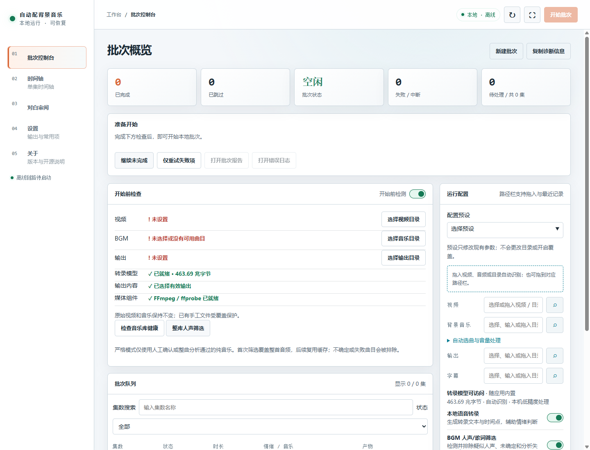

# 自动配背景音乐工作台

一款面向短剧剪辑与内容运营的**本地 Windows 桌面工具**（附命令行模式）。只需选择视频、按情绪整理的 BGM 曲库和输出目录，即可自动完成语音转录、情绪选曲、对白压低并批量导出成片。

- **完全本机离线处理**：不上传视频、音频或字幕；安装包内置 FFmpeg、faster-whisper（small）和 YAMNet。
- **可人工复核**：提供时间轴、对白句段点击试听，以及人声疑似区间复核。
- **安全可恢复**：支持断点续跑与失败重试，默认不覆盖原素材和非本程序生成的产物。



---

## 快速上手（Windows 安装版）

1. 前往 [GitHub Releases](https://github.com/crazyzhang277/short-drama-bgm/releases/latest) 下载 `short-drama-bgm-setup-<版本>.exe` 并安装（会在桌面与开始菜单创建快捷方式）。
2. 在工作台依次选择：
   - **视频**：选择视频目录或单个视频（支持 `.mp4`、`.mov`、`.mkv`、`.webm`、`.avi`、`.m4v`）。
   - **BGM 曲库**：按情绪子目录整理的音乐文件夹（见下文格式）。
   - **输出目录**：建议选择独立空目录。
3. 点击 **开始批次**，等待处理完成后可在 **时间轴** / **对白审阅** 页面试听成片与纯 BGM 效果。

> 正式安装版可在 **关于** 页面检查、下载并安装新版本更新（开发/预览模式不联网检查）。

---

## 核心功能

| 模块 | 能力说明 |
|---|---|
| **智能选曲与转场** | 结合中/英文对白关键词与 FFmpeg 镜头/黑场检测选曲；支持“转场必换曲”、每集曲目数量上下限、曲目交叉淡化与片尾定格。 |
| **人声与曲库筛选** | 默认开启“BGM 人声/歌词筛选”（YAMNet 本地分析），支持疑似人声区间试听及人工确认/禁用；体检会提示重复、静音、过短或损坏音频。 |
| **对白压低与转录** | 内置 `faster-whisper` 本地生成词级/句级对白时间戳（也可导入已有 JSON）；自动在对白时段压低背景音乐音量（auto-ducking）。 |
| **审阅、恢复与报告** | 导出 `*_final.<ext>` 成片、`*_bgm.wav`、`*_timeline.csv`、`*_transcript.json` 与 `run-report.md`；支持“继续未完成”“仅重试失败项”“重新生成当前集”。 |
| **常用工具** | 提供 4 套预设（快速预览 / 标准交付 / 对白优先 / 纯配乐）、拖放导入、最近路径记忆及脱敏诊断信息复制。 |

> **小提示**：页面上的“BGM 人声/歌词筛选”与“开始前检测”开关会独立保存在本机，切换预设不会改动它们；曲库分析缓存保存在 `%USERPROFILE%/.bgm-studio/music-library/`。

---

## BGM 曲库与外置字幕格式

### BGM 曲库目录
按情绪命名子目录，直接放在根目录的音频归为 **默认**（支持 `.wav`、`.mp3`、`.m4a`、`.aac`、`.flac`、`.ogg`、`.opus`）：

```text
BGM/
  默认/calm.mp3
  悬疑/mystery.mp3
  紧张/action.wav
```

### 外置字幕 JSON（可选）
如需使用已有字幕而不是本地转录，在字幕目录放入与视频同名的 `.json` 文件（如 `episode-01.json`）：

```json
{
  "segments": [
    { "start": 12.4, "end": 15.8, "text": "危险，快跑" }
  ]
}
```

---

## 从源码运行与打包

需要 **Windows**、**Node.js >= 22.12.0**，以及已在 `PATH` 中可用的 `ffmpeg` / `ffprobe`。

### 桌面端开发与测试
```powershell
npm ci
npm test                 # 运行单元测试与集成测试
npm run test:desktop-ui  # 运行桌面端 UI 回归检查
npm run desktop          # 启动本地 Electron 工作台
```

### 命令行批处理
```powershell
# 使用外置字幕
node src/cli.js --videos "C:\Media\Episodes" --music "C:\Media\BGM" --output "C:\Media\Output" --transcripts "C:\Media\Transcripts"

# 启用本地 faster-whisper 转录（需安装 requirements.txt 并指定本机模型目录或模型名）
$env:FASTER_WHISPER_MODEL = "C:\Models\faster-whisper-small"
node src/cli.js --videos "C:\Media\Episodes" --music "C:\Media\BGM" --output "C:\Media\Output" --transcribe
```

- CLI 默认沿用桌面版曲库人声缓存；若明确允许使用未分析曲目可加 `--allow-unverified-music`，关闭对白压低可加 `--no-auto-duck`。

### 构建 Windows 安装包
仓库 `models/` 已包含拆分好的 `faster-whisper-small` 归档（构建时自动重组并校验 SHA-256）：

```powershell
npm ci
python -m venv .venv
.\.venv\Scripts\python.exe -m pip install -r requirements-build.txt
npm run dist:win
```

产物输出至 `release/`，包含 `short-drama-bgm-setup-<版本>.exe`、对应 `.blockmap`、`latest.yml` 与 `win-unpacked/`（仅需免安装目录预览时可加 `-Preview` 参数执行 `tools/build-windows.ps1`）。

---

## 已知边界与许可证

- **规则与识别限制**：情绪匹配基于关键词规则、ASR 结果可能存在误差，且会保留原视频音轨；成片交付前请务必人工试听确认。
- **平台范围**：仅针对 Windows 环境开发与测试；使用者需自行确保拥有输入视频与背景音乐的处理及发布权利。
- **开源许可**：本项目原创代码采用 [MIT License](LICENSE)，模型来源与第三方组件许可详见 [THIRD_PARTY_NOTICES.md](THIRD_PARTY_NOTICES.md)、[models/README.md](models/README.md) 与 `licenses/`。
